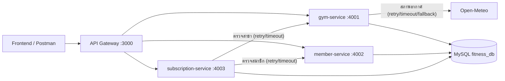

# ระบบข้อมูลฟิตเนส — โครงงานระยะที่ 3 (Final Integration)

ระบบแบ่งเป็น 3 บริการย่อย (Microservices) ด้านหลัง API Gateway รวมเป็นระบบเดียว พร้อมหน้าเว็บ frontend

## วิธีรัน

1. `npm install`
2. สร้างไฟล์ `.env` ที่ root (ใช้ของระยะที่ 2 ต่อได้) อย่างน้อยต้องมี `DB_HOST`, `DB_USER`, `DB_PASSWORD`, `DB_NAME`
3. สร้างฐานข้อมูล: รัน `src/database/schema.sql` แล้ว `src/database/seed.sql`
4. `npm start` (เปิดครบ 4 process ในคำสั่งเดียว) หรือเปิดแยกทีละตัวด้วย `npm run start:gym`, `start:member`, `start:subscription`, `start:gateway`
5. เปิดเบราว์เซอร์: หน้าเว็บ `http://localhost:3000/` · เอกสาร API `http://localhost:3000/api-docs/` · สถานะระบบ `http://localhost:3000/health`

## สถาปัตยกรรม



| บริการ | พอร์ต | ความรับผิดชอบ (Bounded Context) | ตารางที่เขียน |
| --- | --- | --- | --- |
| API Gateway | 3000 | routing, log รวมศูนย์, helmet/cors, จำกัดขนาด body, Swagger UI, เสิร์ฟ frontend, ตอบ 503 เมื่อบริการปลายทางไม่พร้อม | - |
| gym-service | 4001 | สาขาและราคา (UC3, UC4) + สภาพอากาศบริเวณสาขา | gyms |
| member-service | 4002 | ลงทะเบียนและดูข้อมูลสมาชิก (UC1) | members |
| subscription-service | 4003 | บันทึกการสมัคร (UC2) และรายงานประวัติ (UC5) | subscriptions |

## โครงโฟลเดอร์

```
src/
├── gateway/               app.js (ตัวแอป ใช้ทดสอบ) + server.js (listen)
├── gym-service/           app.js + server.js + weather.js (Open-Meteo + fallback)
├── member-service/        app.js + server.js
├── subscription-service/  app.js + server.js
├── shared/                db.js, errors.js, validators.js, external-api.js (timeout/retry)
├── database/              schema.sql, seed.sql, erd.pdf, requirement.md (งานระยะที่ 1)
└── start-all.js           เปิดทุก process พร้อมกัน
```

## การตัดสินใจเชิงสถาปัตยกรรม

- **แบ่งตาม Bounded Context ไม่ใช่ตามชั้นเทคนิค:** สาขา / สมาชิก / การสมัคร สอดคล้องกับ 3 resource ของระยะที่ 1
- **ฐานข้อมูลร่วม (shared database):** ทั้งสามบริการใช้ฐานข้อมูล `fitness_db` เดียวกัน แต่แต่ละบริการเขียนเฉพาะตารางของตัวเอง ข้อดีคือคง FK + `ON DELETE CASCADE` ตาม UC4 (ลบสาขาแล้วลบประวัติการสมัคร) ข้อเสียคือบริการผูกกันผ่านฐานข้อมูล และ subscription-service อ่านตาราง members/gyms ด้วย JOIN เพื่อทำรายงาน (UC5) ถ้าจะแยกฐานข้อมูลจริงต้องเปลี่ยนรายงานเป็นการเรียกข้ามบริการและจัดการ cascade ด้วย event
- **การสื่อสารแบบ Synchronous (HTTP):** การสมัครต้องรู้ผลทันทีว่าสมาชิกและสาขามีจริงหรือไม่ จึงเรียกแบบรอผล
- **Resilience:** เรียกข้ามบริการและเรียก Open-Meteo ผ่าน `shared/external-api.js` (timeout 2-3 วินาที, retry 2 ครั้ง, exponential backoff) ถ้าล้มเหลว: สภาพอากาศคืน fallback, การสมัครตอบ 503 `DEPENDENCY_UNAVAILABLE`, Gateway ตอบ 503 `SERVICE_UNAVAILABLE`
- **Gateway timeout 15 วินาที:** ต้องมากกว่าเวลาสูงสุดที่ gym-service รอ Open-Meteo (3 ครั้ง x 3 วินาที + backoff) ไม่อย่างนั้นผู้ใช้จะได้ 503 แทน fallback ของสภาพอากาศ
- **ยังไม่มีระบบยืนยันตัวตน:** requirement ระยะที่ 1 ระบุบทบาทพนักงาน/ผู้ดูแล แต่โจทย์ระยะที่ 2-3 ไม่ได้กำหนดให้ทำ endpoint ทั้งหมดจึงเปิดใช้งานได้โดยไม่ต้อง login

## ตัวแปร .env (ทุกตัวมีค่าเริ่มต้น ไม่ตั้งก็ได้ ยกเว้น DB_*)

| ตัวแปร | ค่าเริ่มต้น | ความหมาย |
| --- | --- | --- |
| `PORT` | 3000 | พอร์ต Gateway |
| `GYM_SERVICE_PORT` / `MEMBER_SERVICE_PORT` / `SUBSCRIPTION_SERVICE_PORT` | 4001 / 4002 / 4003 | พอร์ตแต่ละบริการ |
| `GYM_SERVICE_URL` / `MEMBER_SERVICE_URL` / `SUBSCRIPTION_SERVICE_URL` | `http://localhost:4001` / `4002` / `4003` | ที่อยู่บริการ (Gateway และ subscription-service ใช้) |
| `GATEWAY_TIMEOUT_MS` | 15000 | เวลารอสูงสุดที่ Gateway รอบริการปลายทาง |
| `SERVICE_CALL_TIMEOUT_MS` / `SERVICE_CALL_MAX_RETRIES` / `SERVICE_CALL_BASE_DELAY_MS` | 2000 / 2 / 200 | การเรียกข้ามบริการ |
| `WEATHER_API_URL`, `WEATHER_LAT`, `WEATHER_LON` | Open-Meteo / พิกัดชลบุรี | สภาพอากาศ |
| `EXTERNAL_API_TIMEOUT_MS` / `EXTERNAL_API_MAX_RETRIES` / `EXTERNAL_API_BASE_DELAY_MS` | 3000 / 2 / 500 | timeout/retry ของ Open-Meteo |
| `ALLOWED_ORIGIN` | - | origin ที่ CORS อนุญาต |

> การออกแบบเต็มตามรูปแบบ Week 13 (ตารางแบ่งบริการ, แผนภาพ, รูปแบบสื่อสาร, จุด Resilience) อยู่ใน `src/microservices-design.md`

## การทดสอบ

```
npm test               # Jest + Supertest ทุก suite (ไม่ต้องใช้ MySQL หรืออินเทอร์เน็ต)
npm run test:coverage  # พร้อมรายงาน coverage (ดูสรุปใน coverage-report.md)
```

- ไฟล์ test อยู่ที่ `src/tests/` (8 suites): `validators`, `gym-service`, `member-service`, `subscription-service`, `gateway`, `external-api`, `db`, `openapi-sync`
- `app.js` ของแต่ละบริการส่งออก `app` โดยไม่ `listen` (แยกจาก `server.js`) เพื่อให้ Supertest เรียกได้โดยไม่ต้องเปิดพอร์ต (รูปแบบเดียวกับ Week 9)
- test `openapi-sync` เทียบ route จริงของทุกบริการกับ `openapi.yaml` ถ้าเพิ่ม/ลบ endpoint แล้วลืมแก้เอกสาร test จะล้มเหลว

## สิ่งที่ต้องตรวจเองบนเครื่องจริง

SQL กับ MySQL จริง (FK/CASCADE/UNIQUE), การเปิดทั้ง 4 process พร้อมกัน, และหน้าเว็บบนเบราว์เซอร์ ดูรายละเอียดใน `coverage-report.md` หัวข้อ "จุดที่ยังไม่มี test ครอบคลุม"
