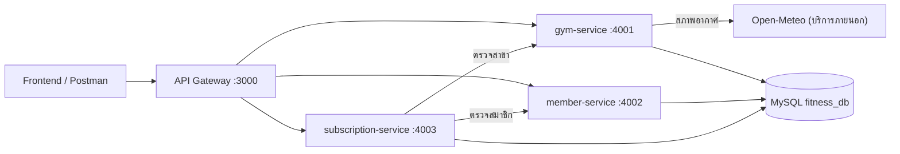

# ออกแบบสถาปัตยกรรม Microservices ของระบบข้อมูลฟิตเนส

เอกสารนี้สรุปการออกแบบตามรูปแบบของ Week 13 (การแบ่งบริการ, แผนภาพ, รูปแบบการสื่อสาร, จุดที่ต้องมี Resilience) ซึ่งถูกรวมเข้าเป็นระบบเดียวในโครงงานระยะที่ 3 รายละเอียดการรันและตัวแปร `.env` อยู่ใน `src/README.md`

## การแบ่งบริการ

แบ่งตามแนวคิด Bounded Context (ตามความรับผิดชอบทางธุรกิจ ไม่ใช่ตามชั้นเทคนิค) ให้ตรงกับ 3 resource ของระยะที่ 1 Gateway ไม่นับเป็นบริการย่อย แต่เป็นจุดเข้าเดียวของระบบ

| บริการ | พอร์ต | ความรับผิดชอบ | Endpoint หลัก (ผ่าน Gateway) |
| --- | --- | --- | --- |
| API Gateway | 3000 | routing, log รวมศูนย์, helmet/cors/จำกัดขนาด body, ตอบ 503 เมื่อบริการปลายทางไม่พร้อม, เสิร์ฟ Swagger UI และ frontend | `/api/v1/*`, `/health`, `/api-docs/`, `/` |
| gym-service | 4001 | ข้อมูลสาขาและราคา (UC3, UC4) และสภาพอากาศบริเวณสาขา | `GET/POST /api/v1/gyms`, `GET/PUT/DELETE /api/v1/gyms/{id}`, `GET /api/v1/gyms/{id}/weather` |
| member-service | 4002 | ลงทะเบียน ดู แก้ไข และลบสมาชิก (UC1, UC6) | `GET/POST /api/v1/members`, `GET/PUT/DELETE /api/v1/members/{id}` |
| subscription-service | 4003 | บันทึกการสมัครแพ็กเกจ (UC2) รายงานประวัติ (UC5) และแก้ไข/ลบการสมัคร (UC7) | `POST/GET /api/v1/subscriptions`, `PUT/DELETE /api/v1/subscriptions/{id}` |

เหตุผล: กฎของสาขา สมาชิก และการสมัครเปลี่ยนด้วยเหตุผลต่างกัน จึงแยก deployment ได้อิสระ ส่วนการสมัครเป็นบริการที่ต้องพึ่งอีกสองบริการ (ตรวจว่าสมาชิกและสาขามีอยู่จริง)

## แผนภาพสถาปัตยกรรม

## รูปแบบการสื่อสาร

| จาก | ไป | รูปแบบ | เหตุผล |
| --- | --- | --- | --- |
| Frontend / Postman | Gateway | Synchronous (HTTP/JSON) | ผู้ใช้รอผลทันที |
| Gateway | gym / member / subscription service | Synchronous (reverse proxy ด้วย HTTP) | ส่งต่อ request และคืน status/body เดิม |
| subscription-service | member-service | Synchronous (HTTP GET) | ต้องรู้ผลทันทีว่าสมาชิกมีจริงก่อนบันทึกการสมัคร |
| subscription-service | gym-service | Synchronous (HTTP GET) | ต้องรู้ผลทันทีว่าสาขามีจริงก่อนบันทึกการสมัคร |
| gym-service | Open-Meteo | Synchronous (HTTP GET) | ผู้ใช้ต้องการสภาพอากาศในคำตอบเดียวกัน |
| ทุกบริการ | MySQL | ฐานข้อมูลร่วม (แต่ละบริการเขียนเฉพาะตารางของตัวเอง) | คง FK และ `ON DELETE CASCADE` ตาม UC4 รายงาน UC5 อ่านด้วย JOIN |

ยังไม่ใช้การสื่อสารแบบ Asynchronous เพราะไม่มีงานที่ไม่ต้องรอผล ถ้าต่อยอด เช่น ส่งอีเมลยืนยันการสมัคร จะใช้ message queue

## จุดที่ต้องมี Resilience

| บริการที่เรียก | บริการปลายทาง | Retry / Timeout / Fallback | เหตุผล |
| --- | --- | --- | --- |
| Gateway | gym / member / subscription service | Timeout 15 วินาที, ไม่ retry, fallback = ตอบ 503 `SERVICE_UNAVAILABLE` | timeout ต้องมากกว่าเวลาที่ gym-service รอ Open-Meteo; ไม่ retry เพราะคำขอ POST/PUT/DELETE ไม่ควรถูกส่งซ้ำโดยอัตโนมัติ |
| Gateway | `/health` ของแต่ละบริการ | Timeout 1 วินาที, ไม่ retry, fallback = นับว่า `down` | health ต้องตอบเร็ว ไม่ควรค้างเมื่อบริการล่ม |
| subscription-service | member-service, gym-service | Timeout 2 วินาที, retry 2 ครั้ง (backoff 0.2 และ 0.4 วินาที), fallback = ตอบ 503 `DEPENDENCY_UNAVAILABLE` | เป็นการอ่านข้อมูลซึ่งส่งซ้ำได้อย่างปลอดภัย ไม่มีค่า default ที่ปลอดภัยแทนการตรวจสมาชิก/สาขา จึงปฏิเสธการสมัครอย่างชัดเจน |
| gym-service | Open-Meteo | Timeout 3 วินาที, retry 2 ครั้ง (backoff 0.5 และ 1 วินาที), fallback = ตอบ 200 พร้อม `weather.available = false` | สภาพอากาศเป็นข้อมูลเสริม ข้อมูลสาขายังใช้งานได้ปกติ |

โค้ดกลไก timeout/retry อยู่ใน `src/shared/external-api.js` ใช้ร่วมกันโดย gym-service และ subscription-service

## ข้อแลกเปลี่ยนที่ยอมรับ

- ฐานข้อมูลร่วมทำให้บริการผูกกันผ่านฐานข้อมูล (ข้อดี: คง FK และ cascade; ข้อเสีย: เปลี่ยน schema ต้องดูผลกระทบทุกบริการ) ดูเหตุผลเพิ่มเติมใน `src/README.md`
- ยังไม่มีระบบยืนยันตัวตนที่ Gateway เพราะโจทย์ระยะที่ 2-3 ไม่ได้กำหนด แนวทางต่อยอดคือให้ Gateway ตรวจ JWT แล้วส่งต่อข้อมูลผู้ใช้ไปยังบริการ
